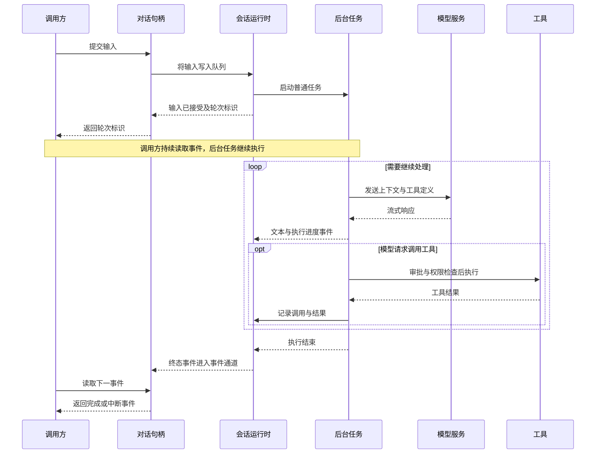

# 对话初始化与轮次执行调用链

本文记录参考 Codex 原仓库梳理的普通请求调用链，并说明本项目的接口对应关系。当前 Go 项目仅定义了公开接口和占位数据类型，以下执行机制尚未实现。

## 1. 模块职责

| 概念 | 职责 |
| --- | --- |
| ThreadManager | 管理多个对话，提供创建、获取、恢复、分叉和关闭等入口。 |
| Thread | 单个对话的公开操作句柄，封装 Session 和输入输出通道。 |
| Session | 内部运行时，管理历史、配置、公共服务、输入队列和活动轮次。 |
| Turn | 一次交互的处理范围，具有轮次标识、上下文和执行状态。 |
| Task | 执行某种工作流程，例如普通请求、审查或独立压缩。 |

原仓库的 `CodexThread` 对应这里的 Thread。Session 跨越多轮交互，当前活动 Turn 关联一个主 Task；Task 内部可以多次调用模型和工具，也可以启动后台异步工作。

## 2. 对话初始化

创建或恢复对话发生在提交轮次之前，已有对话可以重复使用，不需要每次请求都重新初始化。

```text
调用方 / App Server
  → ThreadManager.start_thread() 或恢复接口
    → 初始化 Session
      ├─ 准备配置、历史、模型与工具等公共服务
      ├─ 建立输入队列和事件通道
      └─ 启动 submission_loop，等待输入操作
    → 返回 CodexThread 句柄
```

Thread 表示对话身份及其操作入口，Session 承担运行工作。运行句柄本身是内存对象，持久化的是对话历史与相关信息；恢复时重新建立运行实例。

## 3. 普通请求执行链

### 3.1 输入接收与任务调度

以下以 App Server 提交普通用户输入为例。其他调用方可以直接使用 Core 的对话接口。

```text
用户输入
  → App Server：turn/start
  → CodexThread.start_or_steer_turn()
  → SessionIo.submit_turn_input()
    → 将 Op::TurnInput 写入输入队列
  → Session：submission_loop()
    → turn_input::handle()
      ├─ 已有可追加输入的普通轮次：加入当前轮次的输入队列
      └─ 空闲：创建 TurnContext，启动 RegularTask
        → Session.spawn_task() / start_task()
          ├─ 注册 ActiveTurn 与 RunningTask
          ├─ 准备取消信号
          └─ 启动后台异步任务
            → RegularTask.run()
              → 发送轮次开始事件并进行启动准备
              → RegularTask.run_turns()
                → run_turn()
```

输入路由也可能拒绝请求，例如指定轮次已结束或当前工作流程不支持追加输入。输入提交方法等待路由决定，返回轮次标识和接收方式，不等待整轮执行结束。

### 3.2 模型与工具循环

`RegularTask` 承载普通请求的工作流程，具体 agent loop 位于 `session/turn.rs` 的 `run_turn()` 中。

```text
run_turn()
  ├─ 必要时自动压缩上下文
  ├─ 整理输入、项目规则、Skills、插件和历史
  ├─ 捕获当前模型请求的配置、环境和工具视图
  └─ 循环执行
    → run_sampling_request()
      → build_prompt()
      → try_run_sampling_request()
        → ModelClientSession.stream()
          → 模型服务
        → 处理流式响应
          ├─ 文本增量：发送执行事件
          └─ 工具调用
            → ToolCallRuntime
            → ToolRouter
            → 工具注册表与具体工具实现
              → 按工具需要执行 Hooks、权限检查、审批和沙箱控制
              → 执行本地命令、文件修改或外部工具调用
              → 记录工具调用与执行结果
    → 判断是否继续
      ├─ 有工具后续处理或待处理输入
      │   → 必要时压缩上下文，再次请求模型
      └─ 无后续工作且允许结束
          → 退出循环
```

一次 Turn 可以包含多次模型请求和工具调用。工具结果会进入后续模型请求的上下文；支持并行的工具可以并行执行，存在依赖的步骤仍须等待前置结果。

### 3.3 任务收尾与事件回传

```text
Task 返回
  → Session.on_task_finished()
    ├─ 检查收尾阶段是否需要继续处理已接受的输入
    ├─ 处理完成、错误或中断状态及生命周期回调
    ├─ 发出 TurnComplete / TurnAborted
    └─ 清理活动轮次
```

执行过程中的文本、工具进度、审批请求和终态事件沿独立通道持续回传：

```text
Session / 工具执行过程
  → 事件通道
  → CodexThread.next_event()
  → App Server 转换为客户端通知
  → 界面展示进度与最终状态
```

## 4. 异步执行方式

整体采用异步提交与事件流输出。提交请求返回，只表示输入已被接受；整轮是否结束由后续终态事件表示。



事件读取应由单个读取者持续进行，通常可以放在独立 goroutine 中。`NextEvent()` 等待下一个事件；异步执行不意味着模型与工具的所有步骤都并行。事件可能在输入提交方法返回前就已产生，时序图只用于展示职责关系。

## 5. 压缩、中断与关闭

| 情况 | 执行方式 | 对当前请求的影响 |
| --- | --- | --- |
| 自动压缩 | 普通任务内部调用压缩逻辑，也可以利用后台准备的压缩结果。 | 压缩成功后继续当前工作；失败或取消可能结束执行。 |
| 手动压缩 | Core 收到手动压缩操作后，结束被替换的任务，启动独立 CompactTask。 | 压缩完成即结束该工作流程，不自动恢复被替换的任务。 |
| 中断 | 通过控制操作取消当前任务，执行清理并报告中断。 | 当前轮次停止，对话与历史保留。 |
| 关闭 | 停止当前任务并终止会话运行时。 | 当前运行实例结束，后续需要恢复或新建实例。 |

因此，“执行压缩”不一定意味着切换到 CompactTask。自动压缩可以只是 RegularTask 内部的一个步骤。

手动、自动前台与后台预计算的详细路径见[上下文压缩入口与调用链](context-compaction-call-chains.md)。

## 6. 本项目接口对应关系

当前公开接口定义在 [manager.go](../core/thread/manager.go) 和 [thread.go](../core/thread/thread.go) 中。

`Manager.StartThread`、`ResumeThread` 和 `ForkThread` 通过 `options ...Option` 接收零个或多个可选配置函数。`Option` 的类型为 `func(*config)`，配置结构保持包内私有，后续通过公开的 `WithXxx` 函数提供选项。选项按传入顺序应用到默认配置，相同字段以后传入的选项为准；具体配置字段与默认值后续补充。

| 本项目接口 | 计划职责 |
| --- | --- |
| Manager.StartThread / ResumeThread / GetThread | 创建、恢复或获取对话句柄。 |
| Thread.StartTurn | 仅在空闲时启动轮次，忙碌时返回错误。 |
| Thread.StartOrSteerTurn | 空闲时启动轮次，普通轮次执行中则追加输入。 |
| Thread.SteerTurn | 向指定的活动普通轮次追加输入。 |
| Thread.NextEvent | 等待并消费执行事件。 |
| Thread.Submit | 提交中断、手动压缩、审批响应等控制操作。 |
| Thread.Close | 发起关闭并等待内部运行时退出。 |

`StartTurn()` 的上下文控制提交过程，取消事件读取的上下文只停止本次等待。要停止已经接受的工作，应提交中断操作或关闭对话。

## 7. 原仓库源码定位

以下路径相对于作为参考的 Codex 仓库根目录：

| 路径 | 主要入口与职责 |
| --- | --- |
| codex-rs/app-server/src/request_processors/turn_processor.rs | 接收 turn/start 并调用 Core。 |
| codex-rs/core/src/thread_manager.rs | 创建、恢复与管理对话。 |
| codex-rs/core/src/codex_thread.rs | 对外输入、控制和事件接口。 |
| codex-rs/core/src/session/mod.rs | SessionIo 提交输入与操作。 |
| codex-rs/core/src/session/handlers.rs | submission_loop 分发操作。 |
| codex-rs/core/src/session/turn_input.rs | 判断启动、追加或拒绝输入。 |
| codex-rs/core/src/tasks/mod.rs | 启动任务、中断和收尾。 |
| codex-rs/core/src/tasks/regular.rs | 普通任务工作流程。 |
| codex-rs/core/src/session/turn.rs | agent loop、请求组装和流式响应处理。 |
| codex-rs/core/src/client.rs | 模型通信。 |
| codex-rs/core/src/tools/ | 工具路由、调度、执行和权限控制。 |
