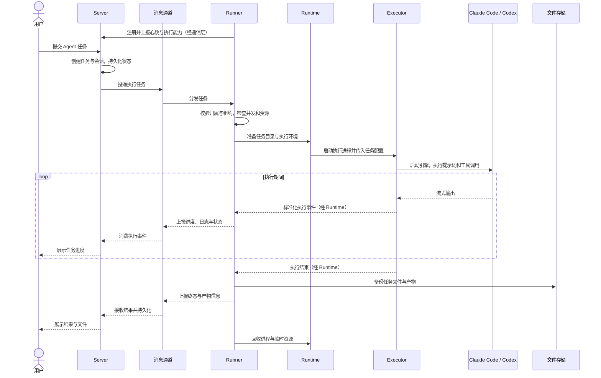

# Infra Agent Cloud

用于探索 Agent 管理与远程任务执行的 Go 项目。本文记录模块职责与计划采用的远程任务流程；目前项目仅初始化了 Go module 和目录，以下能力尚未实现。

分阶段改动与验收标准见[实施计划](./PLAN.md)。

## 1. 模块职责

| 模块 | 职责 |
| --- | --- |
| `server` | 管理 Agent 配置、任务和会话；持久化业务状态；调度任务并接收执行事件；提供查询、停止和追问接口。 |
| `runner` | 作为远程执行节点，注册并上报心跳；接收任务和控制指令；管理并发、会话执行、工作区和执行进程；回传状态与结果。 |
| `executor` | 对接 Claude Code、Codex 等执行引擎；准备引擎命令与配置；调用 MCP 工具；解析输出并统一执行事件。 |

Runtime 是 Runner 内部负责执行环境的组件，管理目录挂载、文件与网络隔离，以及执行进程的启动和销毁。后续可按需要支持直接执行或沙箱执行，目前不单独创建顶层目录。

Runner 表示接收和管理任务的节点，Runtime 表示节点内部承载任务的执行环境，Executor 表示调用具体 Agent 引擎的适配层。

## 2. 远程任务流程

### 2.1 创建与调度

1. 用户选择 Agent，提交提示词及相关输入。
2. Server 解析 Agent 的模型、技能、插件和 MCP 配置，创建任务与会话并持久化业务状态。
3. Server 通过消息通道投递任务，根据 Runner 能力与容量分配执行节点。
4. Runner 接收任务，校验任务归属与租约，检查并发和资源，防止同一会话重复执行。

### 2.2 环境准备与执行

1. Runner 创建任务独立的工作区、配置、会话、缓存和临时目录；继续已有任务时按需恢复文件。
2. Runtime 准备执行环境和隔离策略，启动独立的 Executor 进程。
3. Executor 读取任务配置，启动 Claude Code、Codex 等引擎，并提供任务所需的 MCP 工具。
4. 引擎执行文件操作、命令和工具调用；Executor 将输出转换为统一事件，经 Runner 回传给 Server。
5. Server 更新任务状态，向用户展示日志、进度和输出。

### 2.3 停止与追问

用户发起停止、取消或追问时，Server 根据会话归属，将控制指令发送给实际持有任务的 Runner，再由 Runner 协调执行进程处理。控制请求不依赖 HTTP 负载均衡将请求转发到同一实例。

### 2.4 结束与清理

1. Runner 收敛成功、失败、停止或超时等终态，备份需要保留的任务文件与产物，并回传结果。
2. Server 持久化终态及产物信息，供用户查询。
3. Runner 回收执行进程、网络隔离和临时资源，释放并发占用与租约。
4. 工作区文件按保留策略另行清理，以支持结果查看和后续继续任务。

## 3. 服务边界

- Server 管理业务状态并访问业务数据库；Runner 通过通信层获取任务和回传事件，不直接访问业务数据库。
- 消息通道承担任务、控制指令和执行事件传递，具体实现尚未选定。
- Executor 聚焦引擎调用，通过版本化输入与事件协议和 Runner 协作，不承担业务调度。
- 凭证应通过受控通道传入执行进程，避免写入普通任务消息、命令参数或日志。
- Runner 故障后，可将新任务调度到其他节点；故障节点上正在运行的进程不能直接迁移，继续任务需要结合已保存的会话和文件恢复。
